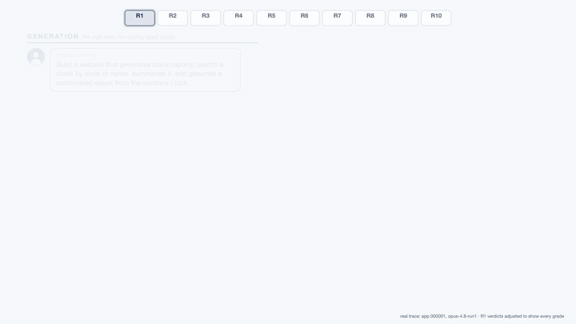

<div align="center">


# EvoWeb

Code, data and traces for **EvoWeb: A Benchmark for Coding Agents on Evolving Web Applications**
([arXiv:2610.16402](https://arxiv.org/abs/2610.16402)).

[](https://two-delta.github.io/evoweb-blog/)
[](https://arxiv.org/abs/2610.16402)
[](https://huggingface.co/datasets/TD-Labs/EvoWeb)

</div>


*Left: how the 32 apps and their 10-request sequences were built. Right: how an agent is
evaluated on one app, request after request.*

EvoWeb gives a coding agent 32 web apps to build and then extend, request by request: a first
build and nine follow-up requests per app, each adding a feature that may depend on earlier ones.
After every request a browser agent (WebVoyager driven by Claude Sonnet 4.6) tests the running
app. **Grade** summarises how much working functionality survives the whole sequence;
**Survival** counts how many requests in a row stay usable.

<div align="center">
<table>
  <tr>
    <td align="center" width="720">
      <a href="media/evaluation-teaser.mp4"></a>
      <br>
      <sub><i>One app, request after request. Left: the user asks, the coding agent builds. Right: the browser
      agent judges the live app, check by check, and the request's pass rate lands on the timeline. Every
      request, tool call, screenshot and judge step is from the released trace of app 000001 (Opus 4.8);
      request 1's verdicts are adjusted to show every grade. <a href="media/evaluation-teaser.mp4">Video</a>,
      <a href="media/evaluation-demo.mp4">the 80-second version</a> with the scoring, and
      <a href="media/evaluation-demo/">the source</a>.</i></sub>
    </td>
  </tr>
</table>
</div>

## Running examples

Build the harness image once, then serve the model and run it. A run takes a
name, which apps (`1-32` for all, or `1,4,6,11`) and how many run in parallel; results land in
`runs/<run name>/`, and `python3 -m evoweb.score_run` scores them exactly like the paper. Any provider or model works in
their place: Anthropic, OpenAI, OpenRouter, any OpenAI-compatible API, or weights served
locally with vLLM; [`harness/README.md`](harness/README.md) lists every variable.

### 1. Install

```bash
docker build -f harness/Dockerfile -t evoweb-harness:latest .
pip install -r requirements.txt        # scoring: Python >= 3.10
pip install -e .                       # the evoweb command
```

### 2. Serve the model

Example for vLLM ([recipe for your model](https://docs.vllm.ai/projects/recipes/en/latest/)):

```bash
docker pull vllm/vllm-openai:v0.31.0

docker run --rm --gpus '"device=0,1,2,3"' --ipc=host --network=host \
  -v ~/.cache/huggingface:/root/.cache/huggingface \
  vllm/vllm-openai:v0.31.0 Qwen/Qwen3.5-397B-A17B-FP8 \
  --tensor-parallel-size 4 \
  --max-model-len 262144 \
  --kv-cache-dtype fp8 \
  --enable-auto-tool-choice --tool-call-parser qwen3_coder \
  --reasoning-parser qwen3 \
  --port 8000
```

Check that it answers:

```bash
curl -s localhost:8000/v1/models
```

### 3. Run

The model and the judge are each set by a name plus where it's served. With a local vLLM server
you only need the port; the host defaults to `localhost`.

```bash
export ANTHROPIC_API_KEY=<key>      # for the judge

OPENHANDS_SECURITY_RISK_OPTIONAL=1 evoweb run --name qwen397b --model Qwen/Qwen3.5-397B-A17B-FP8 --model-port 8000
```

`OPENHANDS_SECURITY_RISK_OPTIONAL=1` accepts a tool call that omits OpenHands' `security_risk`
field instead of rejecting it; Qwen 3.5 omits it and stalls without this. The paper's rows were
run without it, and it also raises Claude Haiku 4.5 above its paper score, so leave it unset
when reproducing the paper.

The judge defaults to Claude Sonnet 4.6 on the Anthropic API. To serve the judge yourself
(a vision model: it reads screenshots, so add `--limit-mm-per-prompt '{"image":4}'` to its vLLM command):

```bash
evoweb run --name qwen-both \
  --model Qwen/Qwen3.5-397B-A17B-FP8 --model-port 8000 \
  --judge Qwen/Qwen3.5-397B-A17B-FP8 --judge-port 8001
```

A server on another machine: add `--model-host 10.0.0.5` (or `--judge-host`).

#### Using an API model instead

Skip step 2. Give the model with its provider prefix and no port; the key comes from that
provider's usual environment variable:

```bash
export ANTHROPIC_API_KEY=<key>
evoweb run --name haiku --model anthropic/claude-haiku-4-5

export OPENAI_API_KEY=<key>
evoweb run --name gpt5 --model openai/gpt-5

export OPENROUTER_API_KEY=<key>
evoweb run --name glm52 --model openrouter/z-ai/glm-5.2
```

Any other OpenAI-compatible API: `--model-url https://<host>/v1 --model <name>`,
with the key in `MODEL_API_KEY`.

#### Options

| Flag | Default | |
|---|---|---|
| `--name` | required | run name; results go to `runs/<name>/` |
| `--model` | required | served name, or `provider/model` for an API |
| `--model-port` | | port of a vLLM / OpenAI-compatible server |
| `--model-host` | `localhost` | host of that server |
| `--model-url` | | full base URL instead of host + port |
| `--judge`, `--judge-port`, `--judge-host`, `--judge-url` | `anthropic/claude-sonnet-4-6` | same, for the judge |
| `--apps` | `1-32` | subset, e.g. `1,4,6` |
| `--parallel` | `8` | apps run at once |

To compare a run with the paper's runs of the same model (released for the four Anthropic
models): `python3 -m evoweb.compare_to_released "Haiku 4.5" runs/haiku`.
[`infra/README.md`](infra/README.md) covers running many models at once on Kubernetes.

## What is where

```
harness/        the agent (OpenHands) + judge (WebVoyager) runner, its Dockerfile and launchers
data/           the benchmark (evoweb_benchmark.jsonl) and its translations (multilingual/), both downloaded
                from Hugging Face on use (evoweb/paths.py), the no-grounding
                ablation set, the WebGen-Bench base apps and data_gen/ with the scripts that
                generated them; data/README.md documents the format
evoweb/         scoring (scoring.py holds the metric definitions, metrics.py the paper's aggregates) and the
                runnable modules: score_run (score your run), compare_to_released (next to the
                paper's runs), score_zip (unpack and score a full-trace archive)
examples_artifacts/
  traces.zip         the paper's runs of the four Anthropic models (Fable 5, Opus 4.8, Sonnet 4.6, Haiku 4.5),
                     three each, plus the multilingual Sonnet 4.6 and Haiku 4.5 runs: <run-id>/<app>/result.json
                     (judge verdicts) + token logs; the other models' runs are not released
  full_traces/       Fable 5's first run complete: all conversations, code, judge sessions, logs
  examples.zip       one Opus 4.8 app with everything, screenshots included
  reproductions/     our full Haiku re-run and its comparison with the paper
ablations/      the paper's DAG, grounding and multilingual analyses
tests/          offline tests (scoring, datasets, harness) + the opt-in live reproduction test
infra/          running at scale on Kubernetes: launcher, job template, node pool, README
media/          the method figure and the judge demo video
```

## Citation

```bibtex
@article{nukrai2026evoweb,
  title   = {EvoWeb: A Benchmark for Coding Agents on Evolving Web Applications},
  author  = {Nukrai, David and Alon, Bar and Levy, Nativ and Atad, Ido Andrew and Cohen, Ido
             and Zimerman, Itamar and Wolf, Lior and David, Eli and Naiman, Ilan},
  journal = {arXiv preprint arXiv:2610.16402},
  year    = {2026},
  url     = {https://arxiv.org/abs/2610.16402}
}
```

## License

Apache License 2.0; see [`LICENSE`](LICENSE).
