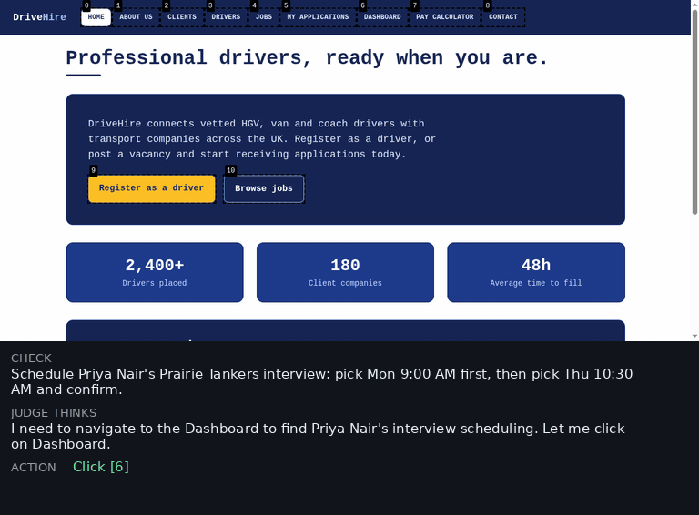

# EvoWeb

Code, data and traces for **EvoWeb: A Benchmark for Coding Agents on Evolving Web Applications**
(ICLR 2027 submission).

[](https://huggingface.co/datasets/TD-Labs/EvoWeb)


*Left: how the 32 apps and their 10-request sequences were built. Right: how an agent is
evaluated on one app, request after request.*

EvoWeb gives a coding agent 32 web apps to build and then extend, request by request: a first
build and nine follow-up requests per app, each adding a feature that may depend on earlier ones.
After every request a browser agent (WebVoyager driven by Claude Sonnet 4.6) tests the running
app. **Grade** summarises how much working functionality survives the whole sequence;
**Survival** counts how many requests in a row stay usable.

<div align="center">
<table>
  <tr>
    <td align="center" width="640">
      <a href="media/webvoyager-demo.mp4"></a>
      <br>
      <sub><i>The judge at work: two checks on the last of the 10 requests of a hiring app that Fable 5
      built, about 20× faster than real time. The browser agent sees the page with numbered elements,
      thinks, acts and gives a verdict. Every step's screenshot, thought and action is kept in the
      traces (<a href="media/webvoyager-demo.mp4">video</a>).</i></sub>
    </td>
  </tr>
</table>
</div>

## Running examples

Build the harness image once, then use one of the three entry points below. Each takes a run
name, which apps (`1-32` for all, or `1,4,6,11`) and how many run in parallel; results land in
`runs/<run name>/`, and `python3 -m evoweb.score_run` scores them exactly like the paper. The outputs
shown are from our own runs of these commands on all 32 apps. Any provider or model works in
their place: Anthropic, OpenAI, OpenRouter, any OpenAI-compatible API, or weights served
locally with vLLM; [`harness/README.md`](harness/README.md) lists every variable.

```bash
docker build -f harness/Dockerfile -t evoweb-harness:latest .
pip install -r requirements.txt        # scoring: Python >= 3.10
```

### 1. Model and judge on APIs

```bash
export API_KEY=<anthropic key> EVAL_API_KEY=<anthropic key>
export MODEL=anthropic/claude-haiku-4-5-20251001 PROVIDER=Anthropic
harness/run_local.sh haiku 1-32 8
python3 -m evoweb.score_run runs/haiku
```
```
| run   | apps | Grade | Survival | Turns / request |
| haiku | 32   | 0.365 | 4.29     | 12.6            |
```

Another API is `PROVIDER=OpenAILike API_URL=https://<host>/v1 MODEL=openai/<model>` (or
`PROVIDER=OpenRouter API_URL=https://openrouter.ai/api`) with its key in `API_KEY`; the judge
moves the same way with `EVAL_MODEL`, `EVAL_API_URL` and `EVAL_API_KEY`.

### 2. Model served locally with vLLM, judge on the API

```bash
EVAL_API_KEY=<anthropic key> GPUS=0,1,2,3 VLLM_ARGS="--kv-cache-dtype fp8" \
  harness/serve_and_run.sh Qwen/Qwen3.5-397B-A17B-FP8 qwen397b 1-32 8
python3 -m evoweb.score_run runs/qwen397b
```
```
| run      | apps | Grade | Survival | Turns / request |
| qwen397b | 32   | 0.310 | 3.67     | 5.7             |
```

The first argument is the Hugging Face repo of the weights; another model family names its
vLLM parsers, for example GLM 5.2 on eight GPUs:

```bash
EVAL_API_KEY=<anthropic key> GPUS=0,1,2,3,4,5,6,7 TOOL_PARSER=glm47 REASONING_PARSER=glm47 \
  VLLM_ARGS="--kv-cache-dtype fp8" \
  harness/serve_and_run.sh nvidia/GLM-5.2-NVFP4 glm52 1-32 8
```
```
| run   | apps | Grade | Survival | Turns / request |
| glm52 | 32   | 0.518 | 5.54     | 12.4            |
```

### 3. Model and judge both served locally with vLLM

The same launcher with a config file naming the two servers, their weights, GPUs and ports
(the shipped one puts Qwen3.5 397B on GPUs 0-3 as the agent and on GPUs 4-7 as the judge):

```bash
harness/serve_and_run.sh harness/configs/b300-qwen397b.env qwen-both 1-32 8
python3 -m evoweb.score_run runs/qwen-both
```
```
| run       | apps | Grade | Survival | Turns / request |
| qwen-both | 32   | 0.322 | 3.88     | 5.7             |
```

To compare a run with the paper's runs of the same model (released for the four Anthropic
models): `python3 -m evoweb.compare_to_released "Haiku 4.5" runs/haiku`.
[`infra/README.md`](infra/README.md) covers running many models at once on Kubernetes.

## What is where

```
harness/        the agent (OpenHands) + judge (WebVoyager) runner, its Dockerfile and launchers
data/           the benchmark (evoweb_benchmark.jsonl) and its translations (multilingual/), both downloaded
                from Hugging Face on use (evoweb/paths.py), the no-grounding
                ablation set, the WebGen-Bench base apps and data_gen/ with the scripts that
                generated them; data/README.md documents the format
evoweb/         scoring (scoring.py holds the metric definitions, metrics.py the paper's aggregates) and the
                runnable modules: score_run (score your run), compare_to_released (next to the
                paper's runs), score_zip (unpack and score a full-trace archive)
examples_artifacts/
  traces.zip         the paper's runs of the four Anthropic models (Fable 5, Opus 4.8, Sonnet 4.6, Haiku 4.5),
                     three each, plus the multilingual Sonnet 4.6 and Haiku 4.5 runs: <run-id>/<app>/result.json
                     (judge verdicts) + token logs; the other models' runs are not released
  full_traces/       Fable 5's first run complete: all conversations, code, judge sessions, logs
  examples.zip       one Opus 4.8 app with everything, screenshots included
  reproductions/     our full Haiku re-run and its comparison with the paper
ablations/      the paper's DAG, grounding and multilingual analyses
tests/          offline tests (scoring, datasets, harness) + the opt-in live reproduction test
infra/          running at scale on Kubernetes: launcher, job template, node pool, README
media/          the method figure and the judge demo video
```

## Citation

```bibtex
@inproceedings{evoweb2027,
  title     = {EvoWeb: A Benchmark for Coding Agents on Evolving Web Applications},
  author    = {Anonymous authors},
  booktitle = {International Conference on Learning Representations (ICLR), under review},
  year      = {2027}
}
```

## License

Apache License 2.0; see [`LICENSE`](LICENSE).
